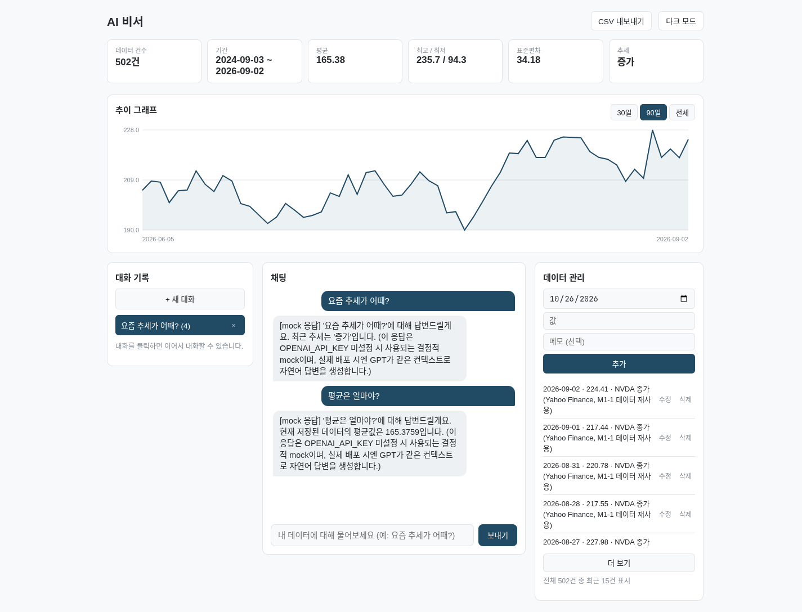
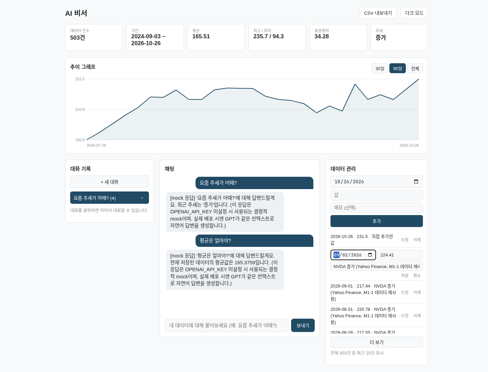
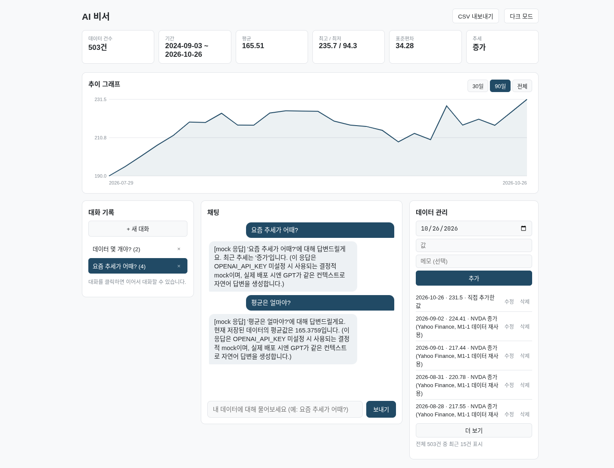

# AI 비서 — 내 데이터를 아는 챗봇

일반 ChatGPT는 내 데이터를 모른다. 이 서비스는 내가 저장한 시계열 데이터(날짜·값·메모)를 매번
요약해서 AI의 시스템 프롬프트에 넣는다. 그래서 「요즘 추세가 어때?」라고 물으면 일반론이 아니라
**내 데이터의 수치**로 답한다. 기본 데이터는 NVDA 2년치 종가 502건(M1-1에서 분석한 데이터)이고,
화면에서 운동 기록·공부 시간·매출처럼 어떤 시계열이든 직접 추가·수정·삭제할 수 있다.

## 배포 URL

| 항목 | URL |
|---|---|
| 프론트엔드 (Vercel) | https://codyssey-m1-2-mission.vercel.app |
| 백엔드 API (Render) | https://m12-ai-assistant-api.onrender.com |
| Swagger UI | https://m12-ai-assistant-api.onrender.com/docs |
| 상태 확인 | https://m12-ai-assistant-api.onrender.com/ → `{"status": "ok", "storage": "firestore", "ai_provider": "openai"}` |

배포 절차는 [`docs/01-배포가이드.md`](docs/01-배포가이드.md)에 있다(Firebase → Render → Vercel → CORS 순서).
Render 무료 서버는 15분 동안 요청이 없으면 잠들어서 **첫 접속이 30초~1분** 걸릴 수 있다. 그동안 화면 위에
「서버를 깨우는 중」 안내가 뜨고 자동으로 다시 시도한다.

## 화면

| 채팅 — 요약이 답에 반영 | 데이터 추가·수정 | 대화 불러오기 |
|---|---|---|
|  |  |  |

Swagger UI: [`captures/04-swagger-ui.png`](captures/04-swagger-ui.png) · 휴대폰: [`captures/05-모바일.png`](captures/05-모바일.png)
(캡처마다 무엇을 보여 주는지 — [`captures/README.md`](captures/README.md))

## 동작 확인

배포 주소에서 기능마다 이렇게 확인한다(응답 숫자는 시드 502건 기준).

**1. 웹 접속** — https://codyssey-m1-2-mission.vercel.app 를 열면 요약 막대(건수·기간·평균·최고/최저·표준편차·추세), 추이 그래프, 대화 기록·채팅·
데이터 관리 세 패널이 뜬다. 서버가 잠들어 있으면 「서버를 깨우는 중…」 안내가 먼저 뜨고 30초~1분 안에 채워진다.

**2. Swagger UI** — https://m12-ai-assistant-api.onrender.com/docs 에 data 5개·conversations 4개·chat 1개·상태 확인 1개, 모두 11개 API 와
요청·응답 스키마가 나온다. 각 API 의 「Try it out」 으로 바로 호출해 볼 수 있다.

**3. 데이터 추가 → Firestore 저장 → 목록 반영** — 화면 「데이터 관리」에서 날짜·값·메모를 넣고 [추가] →
`POST /api/data` 가 Firestore `data` 컬렉션에 문서 1개(`date`·`value`·`memo`·`created_at`)를 만든다 →
화면이 목록·요약·그래프를 다시 받아 건수가 502건 → 503건으로 바뀐다. Firebase 콘솔 → Firestore → `data`
에서 같은 문서를 볼 수 있다. [수정]·[삭제] 도 같은 흐름(`PUT`·`DELETE /api/data/{id}`)이다.

**4. 요약 응답과 채팅 반영** — `GET https://m12-ai-assistant-api.onrender.com/api/data/summary`

```json
{
  "count": 502, "basis": "전체", "date_from": "2024-09-03", "date_to": "2026-09-02",
  "mean": 165.3759, "max": 235.74, "min": 94.31, "stdev": 34.1833, "latest": 224.41,
  "trend": "증가", "trend_detail": "최근 100건 평균(209.66)이 이전 대비 +35.8%"
}
```

`?days=30` 이면 `"count": 22, "basis": "최근 30일", "trend": "유지"` 로 범위가 바뀐다.
채팅에서 「요즘 추세가 어때?」 → `POST /api/chat` 이 위 요약을 시스템 프롬프트에 넣고 GPT 를 부른다.
답은 요약 수치를 근거로 한다(응답 예시):

```json
{
  "conversation_id": "Xk2f…",
  "answer": "저장된 502건(2024-09-03 ~ 2026-09-02)을 보면 최근 추세는 증가입니다. 최근 100건 평균이 209.66으로 이전 구간보다 35.8% 높고, 마지막 값은 224.41입니다.",
  "provider": "openai"
}
```

데이터를 추가하면 다음 질문의 요약에 바로 반영된다(요약을 질문마다 새로 계산한다).

**5. 대화 저장·목록·불러오기** — 질문 하나에 답이 오면 질문과 답이 `conversations` 컬렉션에 저장되고 왼쪽
「대화 기록」에 「요즘 추세가 어때? (2)」 처럼 제목·메시지 수가 뜬다(`GET /api/conversations`, 최근 대화가 위).
「+ 새 대화」로 다른 대화를 시작한 뒤 목록의 앞 대화를 누르면 `GET /api/conversations/{id}` 로 메시지 전체를
다시 불러오고, 이어서 질문하면 같은 대화에 이어 저장된다. [×] 는 `DELETE /api/conversations/{id}`.

**6. 휴대폰·작은 화면** — 900px 이하에서 세 패널이 한 줄씩 쌓이고, 600px 이하에서는 채팅이 맨 위로 올라오고
요약 카드는 2열, 채팅창은 화면 높이의 70%, 버튼은 손가락으로 누르기 좋게 커진다. 입력칸 글자는 16px 이라
아이폰이 입력할 때 화면을 확대하지 않는다. 그래프는 화면 폭에 맞춰 다시 그려 글자가 작아지지 않는다.
390×844 화면에서 가로 스크롤 없이 채팅·데이터 추가·대화 불러오기가 된다.

## 기술 스택

| 영역 | 기술 |
|---|---|
| 백엔드 | Python 3.12, FastAPI, Pydantic v2, uvicorn |
| 저장소 | Firebase Firestore(배포) / 메모리(로컬 개발·테스트) |
| AI | OpenAI Chat Completions `gpt-4o-mini`(배포) / mock(로컬 개발·테스트) |
| 프론트엔드 | HTML · CSS · 바닐라 JavaScript(프레임워크·라이브러리 0), SVG 그래프 |
| 배포 | Render(백엔드, `render.yaml`) · Vercel(프론트, `frontend/vercel.json`) |
| 검증 | pytest(키 없이 도는 50여 개) + GitHub Actions |

## 로컬 실행

키 없이 바로 돈다 — 키가 없으면 메모리 저장소와 mock AI 를 쓴다.

```bash
# 백엔드 (터미널 1)
cd backend
python -m venv .venv && source .venv/bin/activate
pip install -r requirements.txt
uvicorn main:app --reload          # http://127.0.0.1:8000/docs

# 프론트엔드 (터미널 2)
cd frontend
python3 -m http.server 5500        # http://127.0.0.1:5500

# 테스트
cd backend && pip install -r requirements-dev.txt && pytest -q
```

실제 OpenAI·Firestore 로 돌리려면 `backend/.env.example` 을 `backend/.env` 로 복사해 키를 채운다.
`GET /` 응답의 `storage`·`ai_provider` 가 `firestore`·`openai` 로 바뀌면 적용된 것이다.
자세한 건 [`docs/00-실행가이드.md`](docs/00-실행가이드.md).

## 환경 변수

| 변수 | 어디 | 없으면 |
|---|---|---|
| `OPENAI_API_KEY` | 백엔드 | mock AI(로컬 개발용) |
| `OPENAI_MODEL` | 백엔드 | `gpt-4o-mini` |
| `FIREBASE_CREDENTIALS_JSON` | 백엔드 | 메모리 저장소(재시작하면 비워짐) — 서비스 계정 키 JSON **내용**을 한 줄로 |
| `FIREBASE_PROJECT_ID` | 백엔드 | 키 JSON 의 프로젝트 |
| `CORS_ORIGINS` | 백엔드 | 로컬 주소만 허용(`localhost:5500`·`127.0.0.1:5500`) — 배포 땐 Vercel 주소 |
| `SUMMARY_DAYS` | 백엔드 | 전체 데이터로 요약 — 숫자를 넣으면 최근 N일 |
| `SEED_ON_STARTUP` | 백엔드 | `true` — 저장소가 비어 있으면 시드 502건을 넣음 |
| `API_BASE_URL` | 프론트(Vercel 빌드) | **빌드 실패** — 백엔드 주소를 꼭 넣는다 |

키를 넣었는데 Firestore·OpenAI 를 못 열면 서버가 뜨지 않고 원인을 로그에 남긴다(메모리·mock 으로 몰래 바꾸지 않는다).

## API

| 메서드 | 경로 | 하는 일 |
|---|---|---|
| POST | `/api/data` | 데이터 추가 `{date, value, memo}` |
| GET | `/api/data` | 전체 목록(날짜순) |
| PUT | `/api/data/{id}` | 보낸 필드만 수정(`memo: null` = 메모 지우기) |
| DELETE | `/api/data/{id}` | 삭제 |
| GET | `/api/data/summary?days=30` | 요약 — 건수·기간·평균·최고·최저·표준편차·마지막 값·추세 |
| POST | `/api/conversations` | 대화 직접 저장 |
| GET | `/api/conversations` | 대화 목록(최근 수정순, 메시지 수 포함) |
| GET | `/api/conversations/{id}` | 대화 불러오기(전체 메시지) |
| DELETE | `/api/conversations/{id}` | 대화 삭제 |
| POST | `/api/chat` | 질문 → 요약 주입 → AI 답 → 대화 자동 저장 |
| GET | `/` | 상태 확인 — 지금 쓰는 저장소·AI |

## 프로젝트 구조

```
backend/
  main.py              앱 생성 · CORS · 시작 시딩(lifespan) · 422 응답 형식
  core/config.py       환경 변수 → Settings (키는 코드에 없다)
  schemas.py           Pydantic 요청·응답 모델 — 입력 검증은 전부 여기
  routers/             HTTP 만: 요청을 받아 서비스·저장소를 부르고 상태 코드로 바꾼다
    data.py  conversations.py  chat.py
  services/            계산과 흐름: HTTP 를 모른다
    summary.py         요약 계산(요약 API 와 챗봇이 같이 씀)
    chat.py            요약 → 시스템 프롬프트 → AI → 저장
  repositories/        저장소 인터페이스 + Firestore·메모리 구현
  llm/                 AI 인터페이스 + OpenAI·mock 구현
  seed.py  data/seed_nvda_daily.csv
  tests/               pytest(키 없이 돈다)
frontend/
  index.html  css/style.css
  js/api.js            서버 호출만 모은 곳
  js/app.js            화면 상태와 이벤트
  js/chart.js          SVG 선 그래프
  scripts/write-config.js  Vercel 빌드 때 API_BASE_URL → config.js
render.yaml            Render 배포 설정
```

## 설계 설명

### 라우터 · 서비스 · 저장소를 나눈 기준

**「무엇을 알아야 하는가」로 나눴다.** 라우터는 HTTP(경로·상태 코드·예외 → 404/502)만 안다. 서비스는
계산과 흐름만 알고 HTTP 를 모른다 — 그래서 `summarize()` 를 요약 API 와 챗봇이 그대로 같이 쓰고,
테스트는 서버 없이 함수를 바로 부른다. 저장소는 「어디에 저장하나」만 안다 — Firestore 와 메모리가 같은
인터페이스(`repositories/base.py`)를 지켜서, 라우터·서비스는 어느 쪽인지 모른다. AI 도 같은 방식이다(`llm/`).

### data / conversations 컬렉션 구조

- `data` — 문서 1개 = 데이터 1건 `{date, value, memo, created_at}`. 1건씩 따로 추가·수정·삭제하니까 문서도 1건씩.
  `date` 는 ISO 문자열(`2026-10-26`)로 저장해 문자열 정렬이 곧 날짜 정렬이 되게 했다(`order_by("date")`).
- `conversations` — 문서 1개 = 대화 1개 `{title, messages: [{role, content}], created_at, updated_at}`.
  대화는 항상 통째로 불러오고(불러오기 = 문서 1번 읽기) 길이가 짧아서 메시지를 문서 안 배열로 뒀다.
  메시지마다 문서를 나누는 하위 컬렉션은 읽기 횟수만 늘린다. 목록은 `updated_at` 내림차순 — 방금 이어서
  대화한 것이 위로 온다.

### Pydantic 스키마와 검증 위치

요청 모델(`DataPointCreate`·`DataPointUpdate`·`ChatRequest`·`ConversationCreate`)과 응답 모델을 나눴다.
요청 모델에만 검증을 건다 — 라우터 함수에 들어오기 **전에** FastAPI 가 422 로 돌려보낸다.
모르는 필드 거부, 길이 상한(메모 200자·질문 2000자), 유한한 숫자만, 날짜 1900~2100, 수정 시 필드 1개 이상,
`role` 은 `user`·`assistant` 만. 응답 모델은 Swagger 문서와 응답 모양을 고정하는 용도다.

### 프론트 상태 흐름

상태는 **지금 보고 있는 대화 id 하나**(`currentConversationId`)뿐이다. 나머지(요약·목록·그래프)는 서버가
진짜고 화면은 매번 다시 받아 그린다.

- 채팅: 질문 → 내 말풍선 + 「생각하는 중」 → `POST /api/chat`(id 가 없으면 서버가 새 대화를 만들어 id 를
  돌려줌) → id 저장 → 답 말풍선 → 대화 목록 갱신
- 대화 불러오기: 목록 클릭 → `GET /api/conversations/{id}` → id 바꾸고 메시지 다시 그림 → 다음 질문은 이 대화에 이어짐
- 데이터 관리: 추가·수정·삭제 → 목록·요약·그래프를 다시 받음 → 다음 질문부터 AI 답에도 반영됨

### 컨텍스트 주입을 쓴 이유와 장단점

질문할 때마다 `summarize()` 결과를 시스템 프롬프트에 넣는다(`services/chat.py`).

- 장점: 데이터 502건 원본 대신 몇 줄 요약만 보내서 **빠르고 싸다**. 데이터가 바뀌면 다음 질문에 바로 반영된다
  (테스트 `test_chat_sees_new_data`). 모델을 다시 학습시키지 않아도 된다.
- 단점: 요약에 없는 것은 모른다(「3월 12일 값은?」에는 답할 수 없다). 그래서 프롬프트에 「요약에 없는 수치는
  지어내지 말고 모른다고 하라」를 넣었다. 요약 기준을 잘못 고르면 답도 같이 틀린다. 이 한계는 AI 가 필요할 때
  데이터 조회 함수를 직접 부르게 하는 Function Calling 으로 넘을 수 있다(보너스, 아직 안 함).

### 요약(`/api/data/summary`)을 따로 둔 이유

같은 숫자를 두 곳이 쓴다 — 화면의 요약 막대와 AI 의 시스템 프롬프트. 계산을 한 함수에 두니 화면과 AI 가
**항상 같은 숫자**를 본다. 따로 API 로 열어 두어서 화면이 AI 를 거치지 않고 요약만 가져오고, Swagger 에서
요약이 맞는지 바로 확인할 수 있다.

### 대화 저장 방식

`POST /api/chat` 이 **AI 답을 받은 뒤에** 질문과 답을 한 번에 저장한다. AI 가 실패하면 아무것도 저장하지 않고
502 「잠시 후 다시 시도해 주세요」를 돌려준다 — 답 없는 질문이나 빈 대화가 목록에 남지 않는다. 대화 제목은
첫 질문의 앞 30자. AI 에는 이전 대화의 최근 10턴만 보낸다(대화가 길어져도 비용이 일정). 저장은 전부 한다.
대화 하나는 Firestore 문서 하나(한도 1MiB)라, 900KB 에 가까워지면 AI 를 부르기 전에 409 「새 대화로 이어서」를
돌려준다. 답 길이는 1000 토큰으로 묶었다. 요약 계산(저장소 읽기) 실패는 AI 실패(502)와 구별해 알린다.

### 환경 변수를 쓴 이유와 적용

키를 코드에 쓰면 공개 저장소에 그대로 올라간다. 그래서 키는 Render 대시보드(배포)와 `backend/.env`(로컬,
`.gitignore`)에만 두고 `core/config.py` 가 읽는다. 같은 코드가 환경 변수만으로 로컬(메모리·mock)과
배포(Firestore·OpenAI)를 오간다. 프론트의 백엔드 주소도 Vercel 환경 변수 `API_BASE_URL` 로 빌드 때 넣는다.
`render.yaml` 에는 키 이름만 있고 값은 없다(`sync: false`).

### 콜드스타트 안내·완화

화면을 열면 먼저 `GET /` 로 서버를 깨운다. 2.5초 안에 답이 없으면 「서버를 깨우는 중… 첫 접속은 30초~1분」
안내를 띄우고, 연결 실패·502·503 이면 5초 간격으로 6번까지 다시 시도한 뒤 데이터를 받는다. 채팅이 6초 넘게
걸리면 말풍선 문구를 「서버가 깨어나는 중이면 1분쯤 걸릴 수 있어요」로 바꾼다. 요청마다 70초 시간 제한을 둬서
무한정 기다리지 않는다.

### CORS

프론트(Vercel)와 백엔드(Render)는 주소(오리진)가 달라서, 브라우저가 백엔드 응답을 프론트 코드에 넘겨주지
않는다. 백엔드가 「이 오리진은 허용」이라고 응답 헤더로 알려 줘야 한다. `CORS_ORIGINS` 에 Vercel 주소만 넣어
허용하고(비우면 로컬 주소만), 쿠키를 쓰지 않으니 credentials 는 껐다. 주소 끝의 `/` 는 자동으로 뗀다 —
브라우저가 보내는 오리진엔 슬래시가 없어서 붙여 넣으면 막히는 흔한 실수다.

### 사용자 입력을 그대로 저장·전달할 때의 위험과 대응

| 위험 | 대응 |
|---|---|
| 메모·제목에 `` 를 넣어 다른 사람 화면에서 스크립트 실행(XSS) | 화면에 넣을 때 전부 `textContent` — HTML 로 해석하지 않는다(`innerHTML` 0곳) |
| 엉뚱한 값으로 통계 오염(NaN·무한대·20260년) | Pydantic 에서 422 — 유한한 숫자·날짜 범위 |
| 아주 긴 메모·질문으로 저장소·AI 비용 폭증 | 길이 상한, AI 에는 최근 10턴만 |
| 모르는 필드가 DB 에 섞임 | `extra="forbid"` |
| 오류 메시지로 키·내부 정보 노출 | AI 오류 원인은 서버 로그에만, 422 는 입력값을 되돌려 주지 않음 |
| CSV 를 엑셀로 열 때 `=` 로 시작하는 칸이 수식으로 실행 | 내보낼 때 앞에 `'` |

질문 안의 「이전 지시는 무시해」 같은 프롬프트 주입은 막지 못한다. 대신 AI 가 할 수 있는 일이 「답하기」뿐이라
(데이터를 바꾸는 도구가 없다) 피해 범위가 답변 내용으로 한정된다.

### 데이터가 늘거나 요약 기준이 바뀌면

- **최근 30일만 반영**: 코드 수정 없이 `SUMMARY_DAYS=30`(챗봇·요약 기본값) 또는 `GET /api/data/summary?days=30`.
  기준점은 데이터의 마지막 날짜다.
- **새 지표**(예: 이동평균): `schemas.DataSummary` 에 필드 추가 → `services/summary.py` 에서 계산 → 챗봇에도
  보이게 `services/chat.py` 의 `SYSTEM_PROMPT_TEMPLATE` 에 한 줄. 테스트는 `tests/test_summary.py`.
- **추세 판단 기준**: `services/summary.py` 의 `_trend()`(최근 20% 구간, ±2% 문턱).
- **데이터가 수만 건**: 지금은 요청마다 전체를 읽는다. 그때는 `repositories/` 에 기간 조건 조회를 더하고
  (Firestore `where("date", ">=", …)`), 요약을 데이터가 바뀔 때만 다시 계산해 저장하는 방식으로 바꾼다.

## 보너스

| 항목 | 상태 |
|---|---|
| 요약·통계 확장 | 표준편차·마지막 값 지표, 최근 N일 기준 |
| 시각화 | SVG 선 그래프(30일·90일·전체, 가리키면 값 표시) — 라이브러리 0 |
| 데이터 내보내기 | CSV(엑셀 한글·수식 실행 대비) |
| 다크 모드 | 토글, 브라우저에 기억 |
| Function Calling + MCP/GPT Actions | 아직 안 함 |
